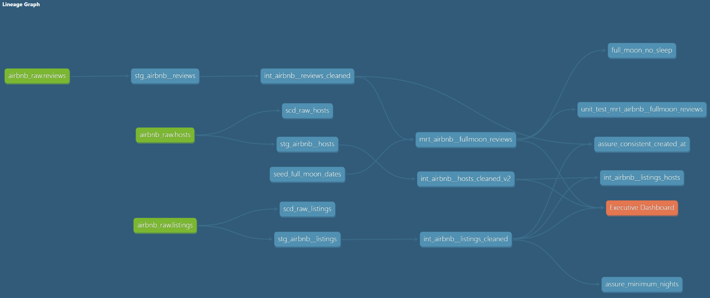

# Modern Data Stack - airbnb_udemy (dbt + BigQuery)

[](https://www.getdbt.com/)
[](https://cloud.google.com/bigquery)
[](https://github.com/tomszy91/airbnb_udemy/actions/workflows/prod_build.yml)
[](https://powerbi.microsoft.com/)
[](LICENSE)

A dbt portfolio project built on Airbnb listing and review data. The pipeline transforms raw staging sources into clean intermediate entities and analytics-ready mart tables, featuring full-moon review analytics, host cleanup logic, and automated CI/CD workflows via GitHub Actions.

**Stack:** dbt 1.10 · BigQuery · GitHub Actions · Power BI

---

## Business context

The project simulates an analytics engineering workflow for short-term rental market analysis. Raw data covering listings, hosts, and reviews is processed to answer key operational and analytical questions without performing heavy transformations in the BI layer:

- How do review volumes and sentiments fluctuate, and is there any correlation with full moon phases?
- Which hosts maintain the highest cleaning standards or listing availability?
- What are the primary trends across active listings and long-term rental categories?

---

## Data sources

| Source | Format | Description |
| --- | --- | --- |
| `raw_listings` | Parquet / Table | Raw Airbnb listing attributes and property details |
| `raw_hosts` | Parquet / Table | Host profile information and response metrics |
| `raw_reviews` | Parquet / Table | User review text, ratings, and timestamps |
| `seed_full_moon_dates` | CSV Seed | Historical full moon calendar dates for lunar correlation analysis |


---

## Project structure

```bash
models/
  staging/
    stg_airbnb__listings.sql                  -- rename, cast, basic cleaning for listings
    stg_airbnb__hosts.sql                     -- rename, cast, basic cleaning for hosts
    stg_airbnb__reviews.sql                   -- rename, cast, basic cleaning for reviews
  intermediate/
    int_airbnb__listings_cleaned.sql          -- deduplicate and filter listing outliers
    int_airbnb__hosts_cleaned.sql             -- clean and standardize host attributes
    int_airbnb__reviews_cleaned.sql           -- clean and filter review records
    int_airbnb__fullmoon.py                   -- Python model joining reviews with full moon data
    int_airbnb__listings_hosts.sql            -- bridge entity combining listings and host data
    int_airbnb__longterm_listings.py          -- filter and process long-term rental segments
  mart/
    mrt_airbnb__fullmoon_reviews.sql          -- final mart analyzing review patterns around full moons
    mrt_reviews_sentiment_score.py            -- aggregated sentiment evaluation per listing/host

seeds/
  seed_full_moon_dates.csv                    -- reference table of full moon dates

macros/
  generate_schema_name.sql                    -- prevents dev/prod prefix collisions
  no_empty_strings.sql                        -- generic data quality test macro
  select_positive_values.sql                  -- custom validation macro for metrics
  drop_dev_schemas.sql                        -- maintenance macro for cleanup

tests/
  assure_consistent_created_at.sql            -- validation on timestamp consistency
  assure_minimum_nights.sql                   -- boundary check for minimum stay rules

reports/
  dashboard.pbix                              -- PBI report - not tracked in Git

.github/
  workflows/
    prod_build.yml                            -- CI/CD production build and test pipeline
    pr_cleanup.yml                            -- automated cleanup workflow for pull requests
    pr_slim_ci.yml                            -- lightweight CI build on pull requests
```

## Lineage



---

## Key design decisions

**Staging is clean and minimal.** Staging models (`stg_`) focus exclusively on renaming columns to a consistent convention and casting data types correctly. No business logic or complex joins are applied at this layer.

**Modular intermediate layer.** Intermediate models (`int_`) handle cleaning, deduplication, and domain-specific transformations. Business logic is isolated so that downstream marts remain clean and performant.

**Hybrid SQL and Python models in dbt.** Leveraging dbt's support for Python models (`.py`) allows for advanced DataFrame manipulations (such as complex full-moon joins and sentiment scoring aggregations) where SQL syntax becomes cumbersome.

**Dedicated mart tables.** The mart layer (`mrt_`) delivers pre-aggregated, business-ready models optimized for direct consumption by Power BI dashboards, eliminating the need for complex DAX calculations on raw data.

---

## Mart tables

| Model | Grain | Primary use |
| --- | --- | --- |
| `mrt_airbnb__fullmoon_reviews` | One row per review / lunar cycle | Analyzing review sentiment and volume relative to full moons |
| `mrt_reviews_sentiment_score` | One row per listing / host | Aggregated sentiment metrics for performance tracking |

---

## Data quality and testing

**Test coverage:**

- Generic tests (`not_null`, `unique`, `accepted_values`) applied across staging sources and key entities.
- Custom singular tests (`assure_consistent_created_at`, `assure_minimum_nights`) verifying business rule constraints.

---

## CI/CD & Automation

Automated via GitHub Actions (`.github/workflows/`):

- **`prod_build.yml`**: Triggers on pushes to `main` and scheduled intervals to execute `dbt build` and run test suites against production.
- **`pr_slim_ci.yml`**: Runs lightweight builds on pull requests to validate modified models efficiently.
- **`pr_cleanup.yml`**: Cleans up temporary schemas and resources after pull requests are closed or merged.

---

## Setup

**Requirements:** Python 3.12+, dbt-bigquery (or target adapter)

```bash
# Install dependencies
dbt deps

# Configure profiles.yml with appropriate credentials
# Run seed data load if applicable
dbt seed

# Build all models and execute tests
dbt build

# Generate documentation
dbt docs generate && dbt docs serve
```

## License

MIT, see [LICENSE](LICENSE).
